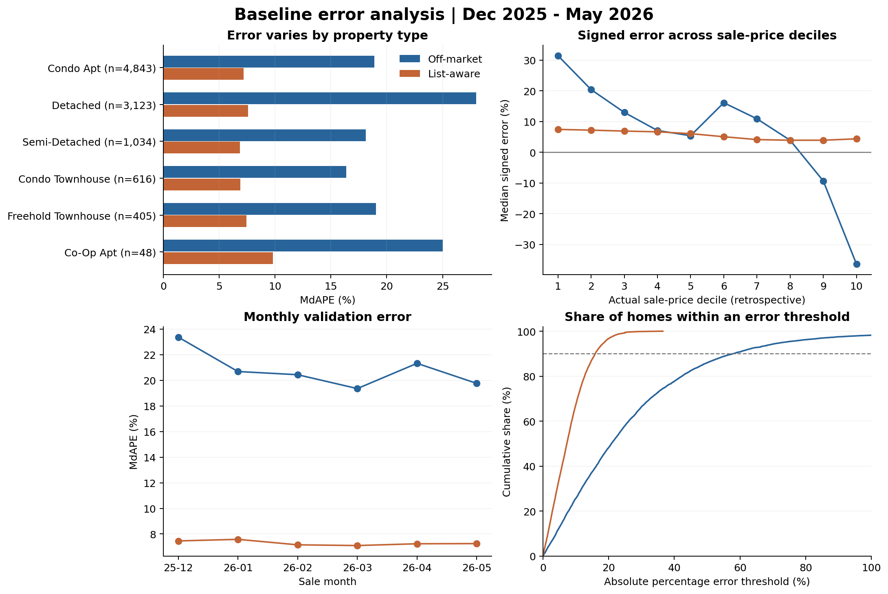
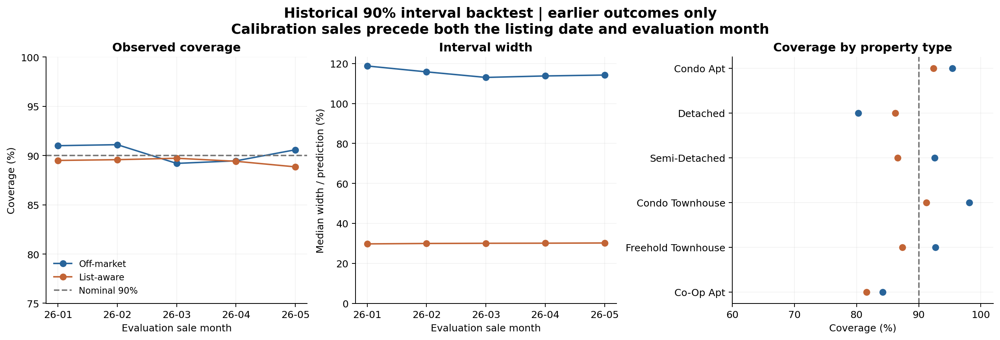

# Baseline 误差分析与不确定性

## 1. 分析对象与指标

输入是已有的逐月验证预测，没有重新训练或优化模型。每条赛道包含 10,069 条预测，覆盖 2025-12 至 2026-05。已用官方 listings 按 `ml_num` 关联社区、行政区、面积、挂牌日期与成交日期，并核对成交价、房型和验证月份一致。

有符号误差为 `100 × (预测价 − 成交价) / 成交价`，正值代表高估。APE 为其绝对值，MdAPE 为 APE 的中位数，MAPE 为 APE 的平均值。所有百分比指标均以百分点显示；区间宽度的分母则是点预测价格。

| 指标 | Off-market | List-aware |
|---|---:|---:|
| MdAPE | 20.84% | 7.26% |
| MAPE | 27.43% | 8.09% |
| 有符号误差中位数 | +8.07% | +5.68% |
| 90% 的房屋误差不超过 | 57.99% | 15.89% |
| 误差不超过 10% 的比例 | 25.60% | 67.37% |
| 误差超过 50% 的比例 | 14.06% | 0.00% |

List-aware 可使用挂牌价，两条赛道的信息条件不同，因此上述差距不能解释为某一模型在同一个任务上比另一模型更好。

## 2. 哪里预测不准

**房型。** Off-market 的 Detached MdAPE 为 27.99%（n=3,123），高于 Condo Apt 的 18.87%（n=4,843）和 Condo Townhouse 的 16.39%（n=616）。Co-Op Apt 的 MdAPE 为 25.01%，但只有 48 套，不能作为稳健排名。List-aware 各主要房型 MdAPE 较接近，但有符号偏差不同，例如 Condo Apt 为 +7.09%，Semi-Detached 为 +0.50%。

**价格。** 按真实成交价分成十组，Off-market 最便宜一组的有符号误差中位数为 +31.44%，最贵一组为 −36.40%，呈现低价高估、高价低估的模式。但以真实结果分组本身会产生选择效应，不能仅凭这张图确定原因；成交价分组只能在事后诊断时使用。代码也输出按预测价分组的诊断，部署时若需价格分层，应仅使用预测时可知的信息，并在训练期固定分组边界。

**月份。** Off-market 月度 MdAPE 在 19.36% 至 23.38% 之间，12 月最高；List-aware 在 7.10% 至 7.58% 之间。六个月不足以推断长期稳定性，也不能把单月差异全部归因于市场趋势，因为房屋构成同时发生变化。

**社区。** 仅在样本量至少 50 的社区中查看高误差组：Off-market 的 Hazelfield 为 35.30%（n=68）、Ashbank 为 35.16%（n=69）；List-aware 的 Cedarheights 为 15.05%（n=65）。这些是探索性排名，未控制房型、价格和月份，也未做多重比较校正，不能认定为独立社区效应。社区名称和地理位置均为合成数据。

## 3. 为什么会错：一个可复查的案例

最大 Off-market APE 案例为 `SYN-0092314`：成交价 $844,000，预测 $4,317,900，APE 411.60%，房型 Detached，面积 1,166 平方英尺。

按官方算法重建其最近 10 套历史成交后，得到完全相同的预测。10 套可比房屋的面积中位数为 1,883.5 平方英尺，只有 3 套处于同一社区，成交时间跨 2021-03-29 至 2025-09-11。另两个最大误差案例的可比房屋也更大：目标 913 平方英尺对应可比面积中位数 1,898.25；目标面积范围 1,300–1,499 对应 3,516.75。

这说明“同房型 + 坐标近”不能保证是合适的可比房屋。算法确实未对面积、社区或成交距今时间做价格调整。不过这些证据仍不能量化每一个因素的因果贡献，需由队友用特征对照实验检验。完整 30 条可比成交记录在 `tables/extreme_case_comparables.csv`。

List-aware 的预测全部等于挂牌价；76.03% 高于成交价，说明本验证期的挂牌价存在整体偏高现象。可以在历史训练折内检验成交/挂牌比校准，但不能直接用全部验证期得到的偏差修正后，再把同一验证期分数称为独立测试结果。

## 4. 两种不同的 uncertainty

### 指标估计的波动

用 1,000 次 bootstrap（随机种子 42）估计总体 MdAPE 的波动：

| 95% bootstrap 范围 | Off-market | List-aware |
|---|---:|---:|
| 逐房屋独立重采样 | 20.41%–21.36% | 7.12%–7.42% |
| 按月份整组重采样 | 19.84%–21.93% | 7.16%–7.40% |

月份重采样保留当月房屋的共同变化，但只有 6 个时间块，因此只是敏感性分析，不是未来测试误差的保证。月份区间不一定比逐房屋区间更宽；List-aware 在这里就没有变宽。以上范围描述“汇总分数的波动”，不代表单套房屋的价格区间。

### 单套房屋的预测区间

为每条赛道单独建立绝对 log 残差分布：`s = |log(成交价 / 点预测价)|`。对目标房屋，校准截止时间为 `min(该房屋挂牌日期, 该验证月份第一天)`。只有成交日期严格早于截止时间的历史验证残差可以进入校准池，不使用同月或未来成交。

当至少有 100 条残差时，设 `k = ceil((n+1) × 0.90)`，取排序后第 k 个残差为 q，构造 `[预测价 × exp(-q), 预测价 × exp(q)]`。阈值 90%、最小样本量 100 和全历史池预先固定，没有根据覆盖率挑选方案。原点预测保持不变。

这是采用 conformal 分位数形式的时间顺序经验区间。市场分布可能变化，且输入残差可能来自逐月更新的模型，因此不宣称严格的交换性或有限样本覆盖保证。

| 回测指标 | Off-market | List-aware |
|---|---:|---:|
| 可评估房屋数 | 8,045 | 8,045 |
| 排除的房屋数 | 2,024 | 2,024 |
| 实际覆盖率 | 90.11% | 89.36% |
| 区间宽度/点预测中位数 | 114.23% | 30.04% |
| 区间宽度中位数 | $1,067,401 | $259,862 |
| Detached 覆盖率（n=2,652） | 80.28% | 86.20% |
| Condo Apt 覆盖率（n=3,621） | 95.44% | 92.38% |

排除的 2,024 套包括 12 月 1,238 套暖启动房屋，以及另外 786 套在挂牌时尚无足够历史校准残差的房屋；它们仍包含在点预测指标中。覆盖率只适用于剩下的 8,045 套，不能外推到被排除房屋。

**结论：Off-market 达到接近 90% 的总体覆盖，代价是很宽的区间，而且 Detached 明显低于名义覆盖。** 下一步值得测试按房型、预测价或局部误差规模调整的区间，采用更早数据校准、后续月份检验，并保留样本不足时的回退策略。当前没有验证这些改进已经有效。

## 5. 报告里可以说什么

可以说：基准模型在不同房型与价位上表现不均；Off-market 的极端错误与不合适的可比成交同时出现；List-aware 有整体高估现象；总体区间覆盖率掩盖了 Detached 的不足。

不要说：这是最终模型的误差、隐藏测试分数已确定、每一套房子都有 90% 的被覆盖概率、社区本身导致误差，或已证明新特征一定能改善结果。预测表核验也不能替代训练代码的泄漏检查。

来源与重现方式见上级目录 `README_中文.md`。方法参考：[Angelopoulos & Bates, conformal prediction introduction](https://arxiv.org/abs/2107.07511)。
